<div align="center">

# 🅿️ Smart Parking Management & Allocation System

**A database-first parking system where a slot can never be double-booked, even when two users ask for it at the same moment.**

[](https://smart-parking-dbms-capstone-production.up.railway.app)


*DBMS Capstone, Project 6 · Database Management Systems (ETCCMS304) · B.Tech Semester III*

**Author:** Aryan Kumar &nbsp;|&nbsp; **Roll No:** 2501010043

</div>

---

## 🔗 Live demo

**<https://smart-parking-dbms-capstone-production.up.railway.app>**

Things to try (the site is connected to a real cloud MySQL database):

| Try this | What you should see |
|---|---|
| User `31`, Vehicle `31`, Slot `1`, 10:00 to 12:00 on a future day → **Reserve this slot** | `SUCCESS: reservation confirmed` |
| User `32`, Vehicle `32`, Slot `1`, 11:00 to 13:00 the same day | `FAILED: Slot already booked for an overlapping interval` |
| User `32`, Vehicle `32`, Slot `1`, 12:00 to 14:00 the same day | `SUCCESS` (back-to-back bookings are allowed) |
| Zone `1` → **Auto-allocate in zone** | the system picks a free slot for you |
| **Cancel** on a confirmed reservation | status changes to `CANCELLED` |

> The demo runs on a free hosting trial, so it may be slow to wake up on the first visit and will be taken down after evaluation. All screenshots below were taken from the running project.

<!-- After adding docs/screenshots/12_live_site_booking_success.png, show it here:
 -->

---

## ✨ Highlights

- **No double booking, guaranteed.** The rule lives in the database, in three layers: a function, locking procedures and triggers. Even a direct `INSERT` cannot break it.
- **Dynamic slot allocation.** Uses `FOR UPDATE SKIP LOCKED`, so two users asking at once get different slots and nobody waits.
- **Real business rules.** Overstay detection, automatic fines, fee calculation, visitor passes, entry/exit logs, audit trail.
- **Secure by design.** Four least-privilege roles, prepared statements against SQL injection.
- **Proven, not just claimed.** 31 test cases plus 4 integrity invariants, two-session concurrency demos, transaction demos with COMMIT, ROLLBACK and SAVEPOINT.

| 16 tables | 8 procedures | 2 functions | 9 triggers | 5 views | 6 indexes | 21 queries | 31 tests |
|:-:|:-:|:-:|:-:|:-:|:-:|:-:|:-:|

---

## 🧱 Architecture

```
 Browser (HTML + JavaScript)
          │  JSON over HTTPS
          ▼
 Flask backend  ──────────────►  MySQL 8.4  (tables, views, procedures, triggers)
 (webapp/app.py)  CALL sp_...      └─ all booking rules are enforced here
          │
          └─ optional: gate/sensor events ──► MongoDB   (flexible event documents)

 OLTP tables ──ETL procedure──►  Star schema  ──►  OLAP reports (ROLLUP)
```

| Layer | Technology |
|---|---|
| Frontend | HTML, CSS, vanilla JavaScript (`webapp/templates/index.html`) |
| Backend | Python, Flask REST API, gunicorn (`webapp/app.py`) |
| Database | MySQL 8.4 on Railway |
| NoSQL extension | MongoDB, aggregation pipelines |
| Analytics | Star schema with an ETL stored procedure |

---

## 📁 Project structure

```
.
├── sql/
│   ├── 01_schema.sql                          tables, keys, constraints
│   ├── 02_functions_procedures_triggers.sql   routines, cursor, triggers
│   ├── 03_seed_data.sql                       realistic sample data
│   ├── 04_views_indexes.sql                   views, indexes, EXPLAIN
│   ├── 05_queries.sql                         21 complex queries
│   ├── 06_transactions_concurrency.sql        COMMIT / ROLLBACK / SAVEPOINT, two-session demos
│   ├── 07_security_rbac.sql                   roles, grants, SQL-injection demo
│   ├── 08_star_schema_etl.sql                 star schema + ETL
│   ├── 09_test_cases.sql                      31 tests + 4 invariants
│   └── 10_invariant_proof_queries.sql         proof queries
├── webapp/                                    Flask backend + HTML frontend
├── app/parking_app.py                         command-line integration demo
├── mongodb/gate_events.js                     NoSQL extension
├── docs/screenshots/                          evidence screenshots
├── er_diagram.mermaid                         ER diagram (open it at mermaid.live)
└── run_all.sh                                 runs the SQL files in order
```

---

## 🚀 Run it locally

**Requirements:** MySQL 8.0.31 or newer (needed for `INTERSECT`, `EXCEPT`, `SKIP LOCKED`), Python 3.8+.

**1. Create the database.** In MySQL Workbench, open and execute these files in order:
`01` → `02` → `03` → `04` → `07` → `08`.
File `02` must run before `03`, because the sample data relies on the triggers.
If you see error 1418, run `SET GLOBAL log_bin_trust_function_creators = 1;` and rerun `02`.

**2. Start the website.**

```bash
cd webapp
pip install -r requirements.txt
# Windows PowerShell:  $env:DB_PASS = "User#2026"
python app.py
```

Open <http://127.0.0.1:5000>.

**3. Optional extras.**
`mongosh mongodb/gate_events.js` for the NoSQL part, `python app/parking_app.py --concurrency` for the automated race test.

> The passwords in `07_security_rbac.sql` are demo values for local use only.

---

## 🧠 How double booking is prevented

Two intervals overlap when `start1 < end2 AND end1 > start2`.
So 10:00–12:00 and 12:00–14:00 are allowed, while 10:00–12:00 and 11:00–13:00 are not.

1. Every booking procedure first **locks the slot row** with `SELECT ... FOR UPDATE`.
2. A competing session **waits**, then sees the committed booking and is rejected.
3. Dynamic allocation uses **`SKIP LOCKED`**, so the second user receives the next free slot instead of waiting.
4. **Triggers** repeat the same check, so even a direct `INSERT` cannot create a conflict.
5. Deadlocks are avoided by locking one resource first, keeping transactions short, and retrying on error 1213.

---

## 📸 Evidence

| | |
|:-:|:-:|
| 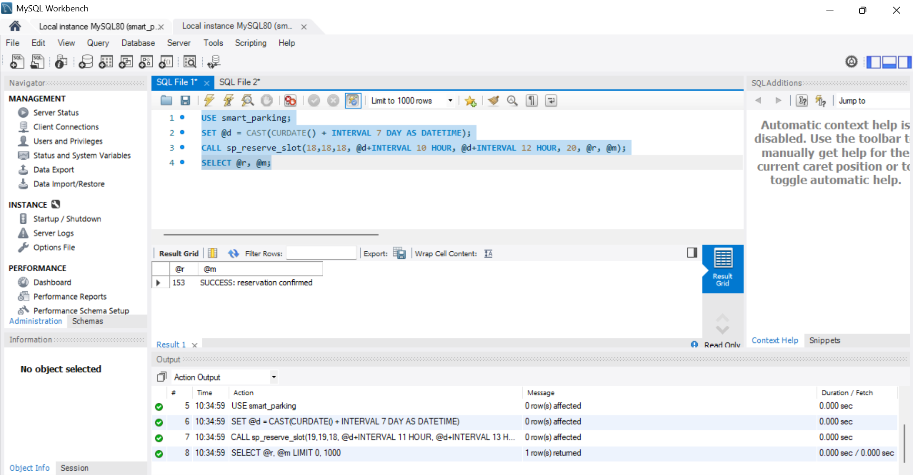<br>**Session A** books 10:00–12:00 | 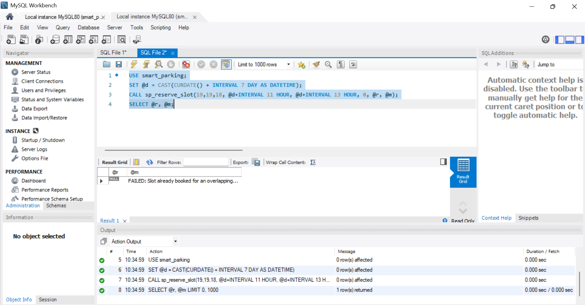<br>**Session B** asks 11:00–13:00 and is rejected |
| 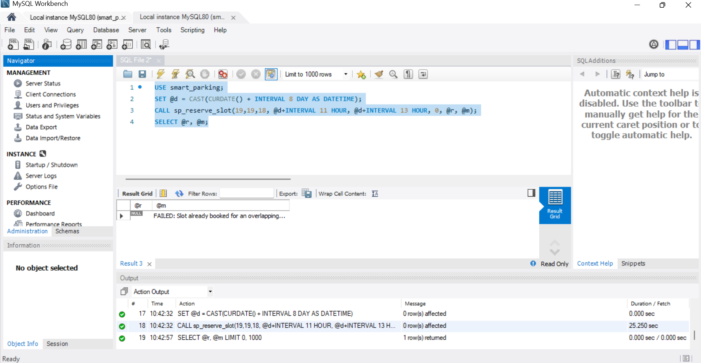<br>Session B **waited ~25 s** on the row lock | 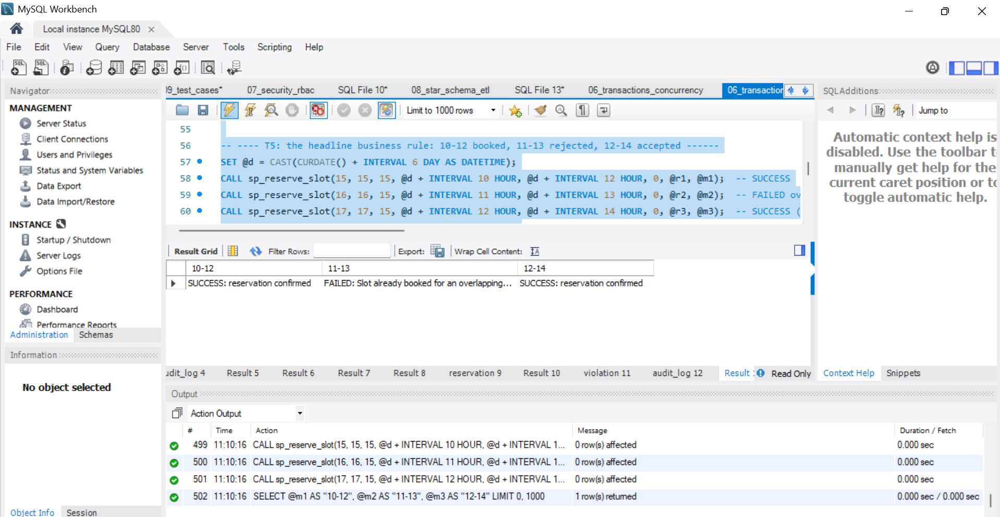<br>10–12 accepted, 11–13 rejected, 12–14 accepted |
| 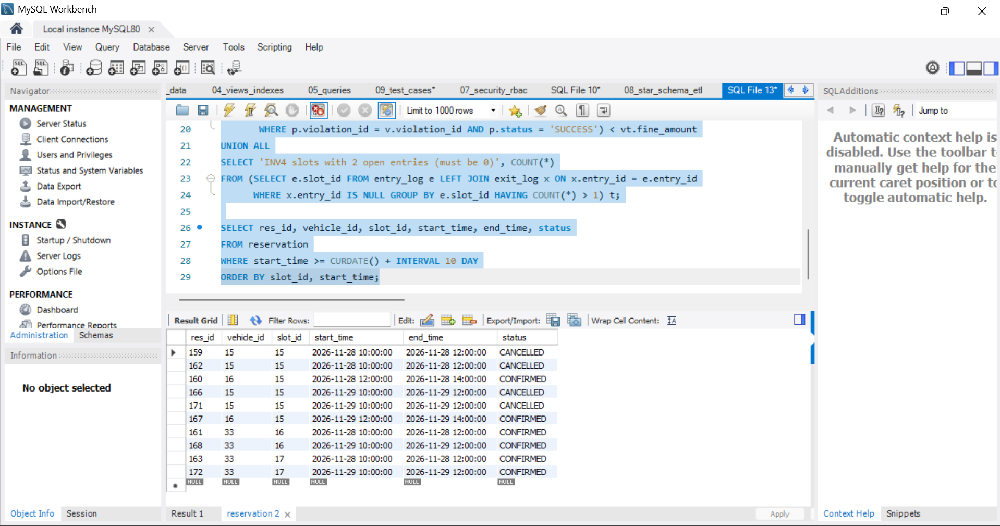<br>Resulting data has **no overlap** | 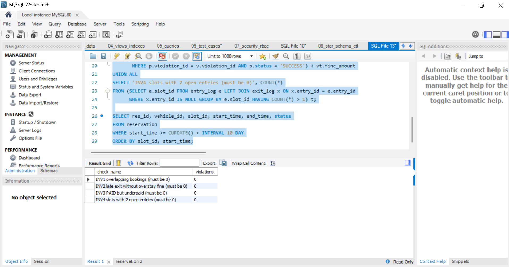<br>All four **integrity invariants = 0** |
| 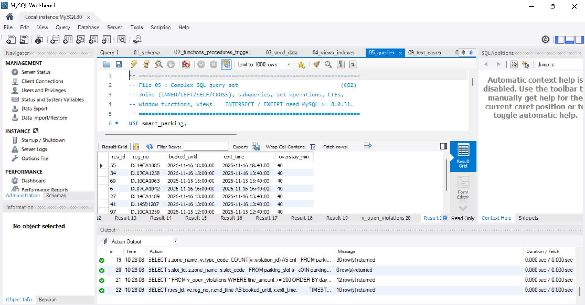<br>**Complex queries** (file 05) | 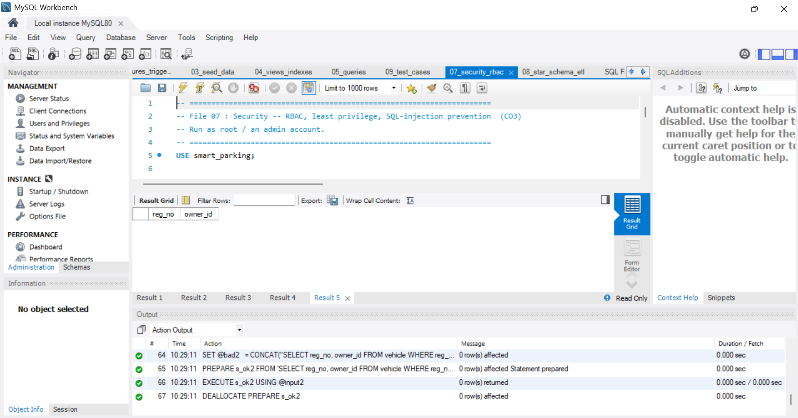<br>**SQL injection** blocked by a prepared statement |
| 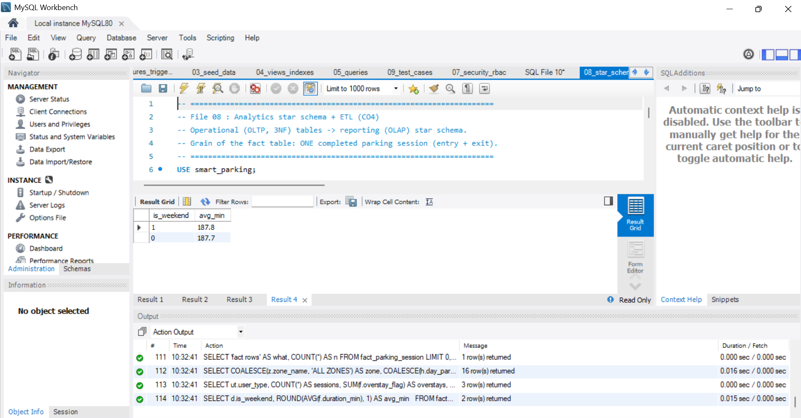<br>**Star schema + ETL** results | 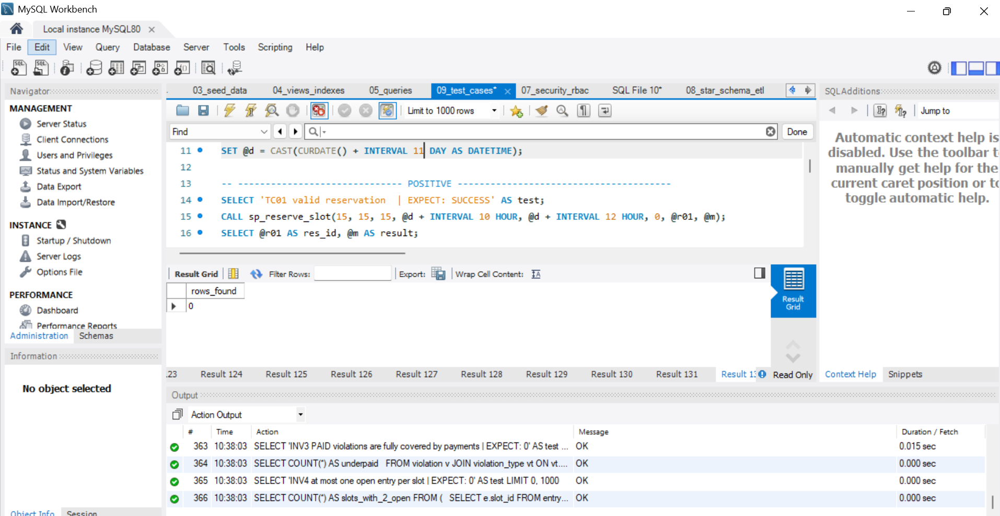<br>**Test cases** (file 09) completed |

<details>
<summary>More: schema creation</summary>

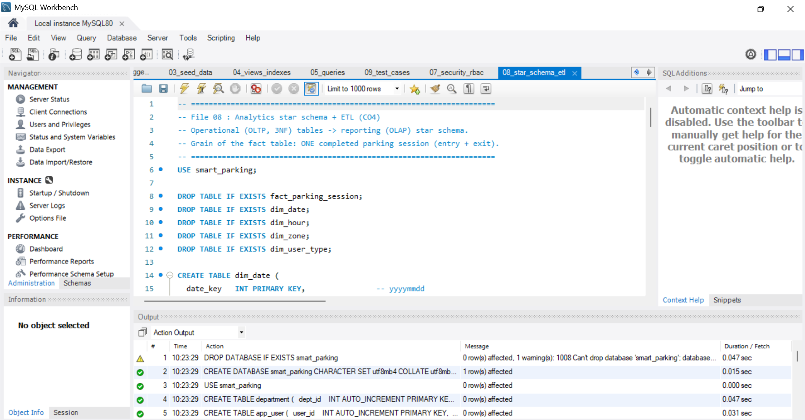

</details>

---

## 📚 Syllabus coverage

| Unit / CO | Covered by |
|---|---|
| **Unit 1 / CO1** | ER/EER design, keys, constraints, functional dependencies, 3NF/BCNF |
| **Unit 2 / CO2** | DDL, DML, DCL, TCL, all join types, subqueries, set operations, views, indexes, window functions, CTEs |
| **Unit 3 / CO3** | ACID, COMMIT/ROLLBACK/SAVEPOINT, locking and deadlocks, procedures, functions, cursor, triggers, RBAC, SQL-injection prevention |
| **Unit 4 / CO4** | MongoDB with aggregation, star schema + ETL, Flask web application on a cloud database |

---

## ⚠️ Honest notes

- MySQL has no exclusion constraint, so overlap prevention uses locking plus triggers.
- The cloud copy connects as the database owner. The least-privilege roles are demonstrated on the local database (`07_security_rbac.sql`).
- The web app has no login screen; you type a user ID. A real system would add authentication.
- Fees use simple hourly pricing.

<div align="center">

Built for the DBMS capstone · **Aryan Kumar** · Roll No. **2501010043**

</div>
